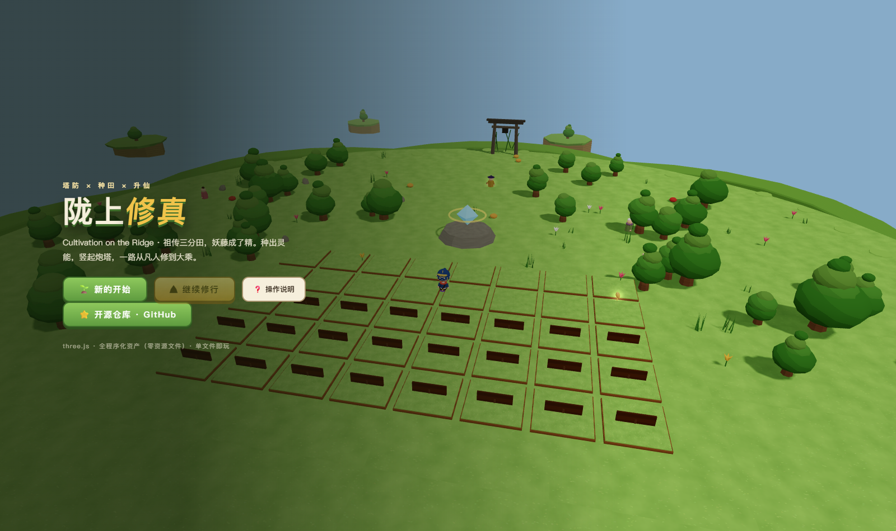
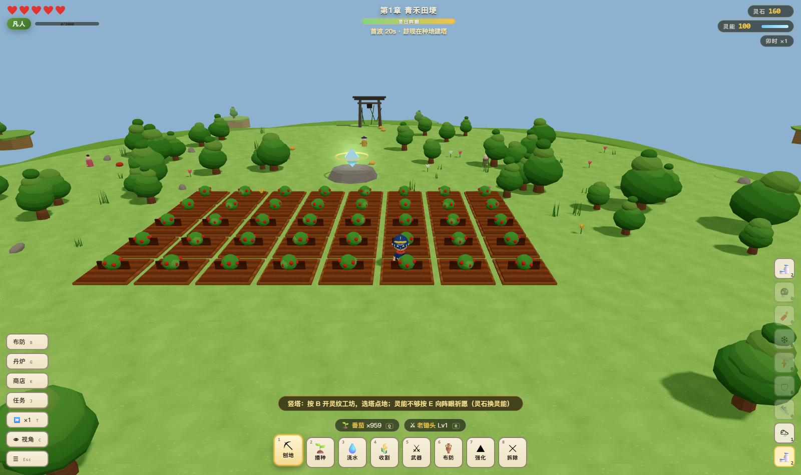
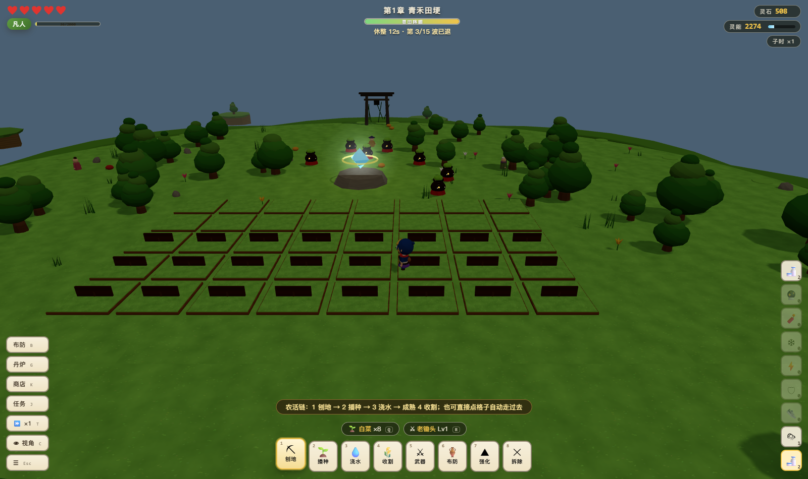
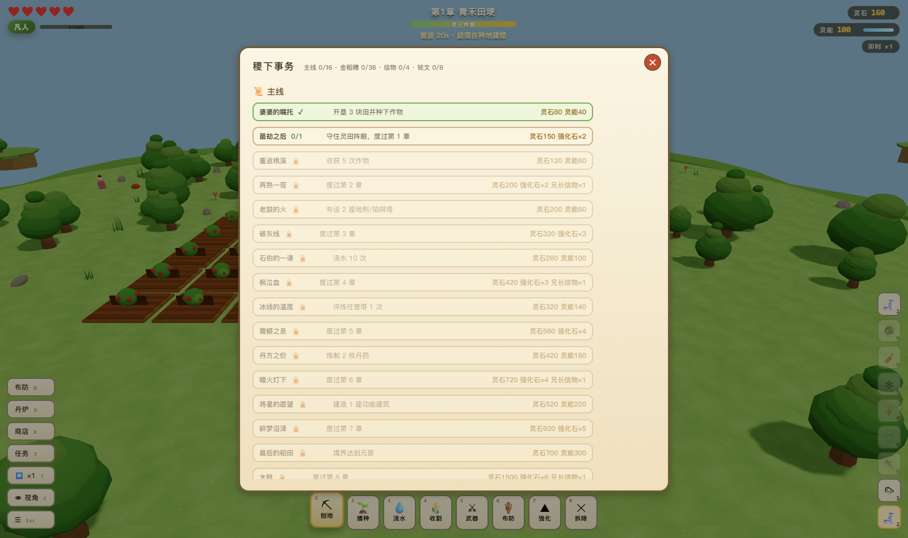

# 陇上修真 · Cultivation on the Ridge

**种田 × 塔防 × 升仙**的 3D 卡通开放世界 RPG。单 HTML 文件，零资源、零依赖、零构建工具链——双击即玩。

> 🎮 **在线试玩：https://lincong1987.github.io/farming-to-cultivation/**
> ⬇️ 或下载 [dist/陇上修真.html](dist/陇上修真.html)（约 1 MB 单文件），断网也能玩。

| | |
|---|---|
|  |  |
|  |  |

## 这是个什么游戏

祖传三分田，妖藤成了精。你白天开垦播种、入夜竖塔守田，一路从凡人修到大乘——最后飞升，或者回家吃饭。

- **开放世界八区互通**：不是一关一关的关卡盒。守清一章，北山门点亮，走过去即入下一章（境界/背包/建筑全继承），南门随时折返旧区补种刷丹
- **种田**：12 种作物四阶段生长，16→40 畦农田分阶开垦；点一下格子自动寻路完成农活；灵泉井、稻草人、鸡舍、谷仓等功能建筑可摆放可升级
- **塔防**：18 座炮塔（品质白→橙、火冰雷物理真实五系克制）、单塔 5 级 + 局外永久淬炼、增益光环/破甲/冻结/击退/经济塔；三难度 15 波/章，第 15 波 BOSS
- **升仙**：46 种怪物、9 阶境界、炼丹突破、8 武器 ×5 级——你亲手种出的粮就是修为
- **剧情**：八章主线任务链 + 支线/每日/成就 + 隐藏收集（金稻穗 ×36、兄长信物 ×4、稷神铭文 ×8）+ **双结局**

## 技术

- Three.js（内联）+ 全程序化资产：贴图 canvas 手绘、模型几何体拼装、音效音乐 WebAudio 实时合成，**无任何外部资源文件**
- 单 HTML 构建（`node tools/build.mjs`，10 个模块内联输出 ~1 MB）
- 静态装饰按（几何 × 材质）合桶 InstancedMesh，整机 draw call ≈ 52
- 自带无头测试 harness（Playwright）：全流程验收 32 项、功能回归 10 项、问题探针 0 项、数值双跑模拟（推荐构筑八章守稳 / 裸奔必守不住）
- 存档 localStorage，含离线闭关收益（8 小时封顶）

```bash
# 二次开发
git clone https://github.com/lincong1987/farming-to-cultivation
cd farming-to-cultivation
node tools/build.mjs        # 重新打包单文件到 dist/
node tools/verify.mjs       # 无头全流程验收（需 node + playwright）
```

## 致谢

本项目由 **基元律动** 公司的 **NeoHorse-1.5-Flash Preview** 模型开发——全部代码（引擎、玩法、美术算法、音频合成、测试工具链）均由该模型编写与调试。

## 联系

- GitHub：[@lincong1987](https://github.com/lincong1987)
- Email：[lincong1987@gmail.com](mailto:lincong1987@gmail.com)
- 社区：[linux.do](https://linux.do)

Issues 与 PR 都欢迎。玩得开心——别忘了天黑前把塔竖起来。

## License

[MIT](LICENSE)
